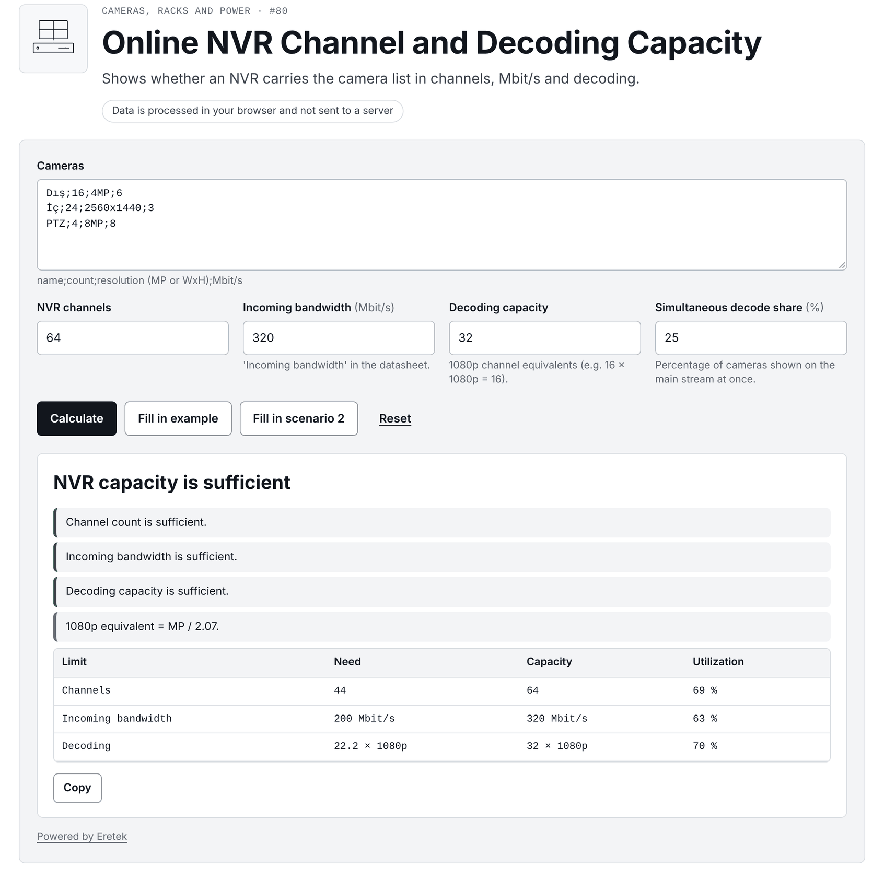

# NVR Channel and Decoding Capacity

Check whether a camera list fits an NVR's channel count, incoming bandwidth limit and live/playback decoding capacity (1080p equivalents).

## Try it live

- [Türkçe](https://kamera.eretek.com/araclar/nvr-kanal-decode-kapasitesi)
- [English](https://kamera.eretek.com/en/tools/nvr-channel-decoding-capacity)
- [Deutsch](https://kamera.eretek.com/de/werkzeuge/nvr-kanal-dekodierkapazitaet)



## What it does

Shows whether an NVR carries the camera list in channels, Mbit/s and decoding.

An NVR datasheet has three separate limits: channel count, incoming bandwidth and decoding capacity (e.g. '16 × 1080p'). Even when channels suffice, 4K cameras can exceed incoming bandwidth or the number of cameras that can be shown at once. The tool checks all three from resolution and bitrate.

## Where it helps

If a limit is exceeded: a higher NVR model, a second NVR, sub-stream viewing or moving to H.265. Continue with the CCTV Storage Calculator for disk.

## How to use it

1. Enter camera groups as `name;count;resolution;Mbit/s`; resolution as 4MP or 2560x1440.
2. Enter channel count, incoming bandwidth and decoding capacity (1080p channel equivalents) from the datasheet.
3. Enter the share of cameras decoded simultaneously for live view and press Run.

### Fields

| Field | Description |
|---|---|
| Cameras | name;count;resolution (MP or WxH);Mbit/s |
| NVR channels |  |
| Incoming bandwidth | 'Incoming bandwidth' in the datasheet. |
| Decoding capacity | 1080p channel equivalents (e.g. 16 × 1080p = 16). |
| Simultaneous decode share | Percentage of cameras shown on the main stream at once. |

## Example input

Press **Fill in example** in the tool to load this input.

| Input | Value |
|---|---|
| NVR channels | `64` |
| Incoming bandwidth | `320` |
| Decoding capacity | `32` |
| Simultaneous decode share | `25` |

**Cameras**

```text
Dış;16;4MP;6
İç;24;2560x1440;3
PTZ;4;8MP;8
```

**Expected result:** 44 channels (69 % of 64), 200 Mbit/s (63 % of 320); with 25 % of cameras viewed on the main stream at once 22.2 × 1080p equivalents are decoded (70 % of 32). The NVR is sufficient.

## Method and assumptions

1080p equivalent = camera MP / 2.0736 (1920 × 1080). Decoding need = Σ count × equivalent × simultaneous share. Utilization above 80 % amber, above 100 % red.

## Limits and common mistakes

- Vendors define decoding differently by fps and codec (e.g. 4K@30 vs 1080p@30); H.264/H.265 differences and fast playback are not modelled.

## Run it locally

The tool is plain HTML, CSS and JavaScript with no build step and no dependencies.

```bash
git clone https://github.com/eretek/nvr-channel-decoding-capacity.git
cd nvr-channel-decoding-capacity
node scripts/serve.js        # or: python3 -m http.server 8080
```

Open <http://127.0.0.1:8080/>. Add `?lang=tr` or `?lang=de` for Turkish or German; without it the page follows the browser language and falls back to English. You can also open `index.html` directly from disk.

Run the tests (Node.js 18 or later):

```bash
node test/run.js    # or: npm test
```

The tests run the tool's own fixtures and the worked examples in all three languages without a browser.

## How it works

All processing happens in your browser. The tool makes no network requests, uses no cookies or browser storage, and does not upload files you select.

No server-side component is needed. The version on the Eretek website renders the same page through a private WordPress plugin; that plugin only produces the page markup and is not part of this repository.

| Path | Purpose |
|---|---|
| `index.html` | Page shell |
| `src/app.js` | Builds the page in Turkish, English or German from `src/data.js` |
| `src/data.js` | Field definitions, examples and all texts in three languages |
| `src/core.js` | Shared runtime: validation, number formats, result rendering, CSV/ICS export |
| `src/tool.js` | The calculation or analysis for this tool |
| `docs/screenshot.png` | Screenshot used in this README |
| `src/tools.css`, `src/page.css` | Styles |
| `test/run.js`, `test/cases.json` | Headless tests |

## License and attribution

This tool is released under the [Eretek Website Attribution License](LICENSE). You may use, modify and redistribute it, including commercially. If you make it available on a website or web application, show a visible, clickable credit linking to https://eretek.com/ on every page where the tool is available, for example:

```html
<a href="https://eretek.com/">Powered by Eretek</a>
```

You may add `rel="nofollow"` to the link. Keep the copyright notice and license text in copies and redistributions.
